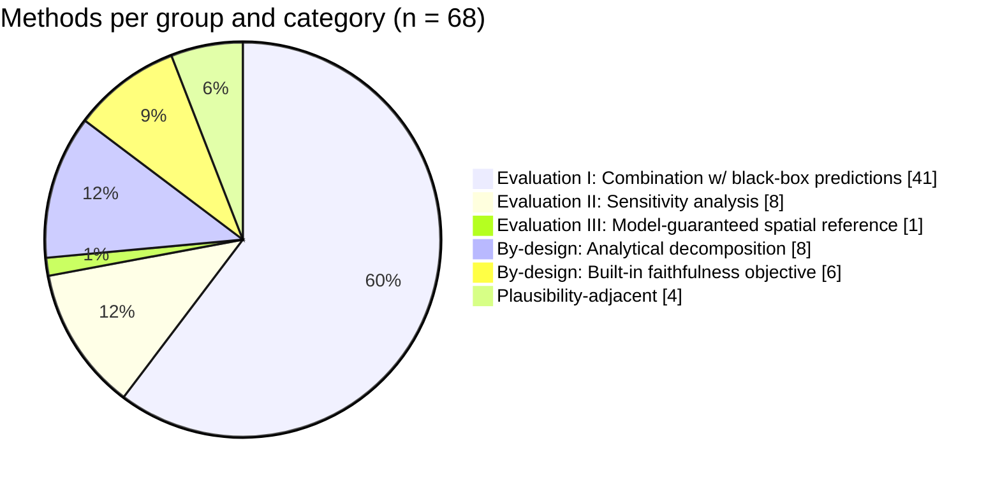

# xai-faithfulness-taxonomy

Interactive classification of the **68 faithfulness methods** identified in
**107 studies** on post-hoc attribution maps in imaging explainable AI (XAI):
a **taxonomy of 50 faithfulness evaluation methods**, plus **14
faithfulness-by-design attribution methods** and **4 plausibility-adjacent
methods**. Companion site and data to the systematic review by Lamprou,
Kallipolitis, Ntanos & Askounis (2026).

## The interactive site

The site lets you browse all 68 methods grouped by group and category, with
full-text search (including the review studies) and group/category filters.
Each method shows its defining reference, the included review studies that
employ it, and the table of the paper where it is listed.

**Live site:** <https://nasskall.github.io/xai-faithfulness-taxonomy/>

> ℹ️ The site is served by GitHub Pages from this repository. On the GitHub
> Free plan Pages only serves **public** repositories, so the live URL works as
> long as this repository stays public; if it is made private again the URL
> returns 404 until it is public once more. You can always run it locally
> regardless of visibility - see [Local preview](#local-preview).

## The paper

**Faithfulness of Post-hoc Attribution Maps in Imaging XAI: A Systematic Review and Taxonomy of Evaluation Methods** (2026).

**Authors:** Vangelis Lamprou¹\*, Athanasios Kallipolitis², Christos Ntanos¹,
Dimitris Askounis¹

- ¹ Decision Support Systems Laboratory, National Technical University of
  Athens, 9 Iroon Polytechniou str., 15780, Zografou, Athens, Greece
- ² Department of Digital Systems, University of Piraeus, 18534 Piraeus, Greece
- \* Correspondence: `vlamprou@epu.ntua.gr`

**Summary.** Faithfulness is one of the most widely used properties for
evaluating explanation quality in XAI, but it is not uniformly conceptualized
across studies. This review systematically investigates how faithfulness is
operationalized in post-hoc, attribution-based XAI for imaging data. A
systematic search of Scopus and IEEE Xplore (final search 15 December 2025)
included studies that focused on the imaging modality, employed neural
networks, produced post-hoc visual explanations with attribution scores, and
defined and numerically quantified faithfulness. The **107 included studies**
yield **68 methods**, classified on a conceptual basis into three groups:

| Group | Paper section | Methods | Review studies |
|-------|---------------|--------:|---------------:|
| Faithfulness evaluation methods (the taxonomy) | 3.3 | 50 | 94 |
| Faithfulness-by-design attribution methods | 3.4 | 14 | 13 |
| Plausibility-adjacent methods | 3.5 | 4 | 5 |
| **Total** | | **68** | **107**\* |

\* Some studies contribute to more than one group.

A method is classified as **faithfulness-by-design** if it produces the
attribution map itself, incorporating faithfulness into its generation, rather
than evaluating a given map. Among the remaining methods, those whose reference
is a spatial region assumed, rather than guaranteed by the model, to be relevant
to the model's output are classified as **plausibility-adjacent**; all others
are **faithfulness evaluation methods**.

The taxonomy organizes the 50 evaluation methods into three categories, based
on how attribution scores are used to formulate a faithfulness argument:

| # | Category | Methods |
|---|----------|--------:|
| I | Combination of attribution scores and black-box predictions | 41 |
| II | Sensitivity analysis of attribution scores | 8 |
| III | Spatial alignment against a model-guaranteed reference | 1 |

Within the taxonomy, perturbation-based reasoning underpins **44 of the 50**
evaluation methods and linearity assumptions **10**. The statistics refer to
the literature that explicitly uses the term *faithfulness*, which defines the
search strategy of the review.

**Keywords:** faithfulness; explainable artificial intelligence; attribution
maps; post-hoc; systematic review; imaging data; taxonomy

## Data

`taxonomy.json` contains all **68 methods**, transcribed from **Tables 2-13**
of the paper. Distribution:

| Group | Category / sub-category | Paper table | Methods |
|-------|-------------------------|:-----------:|--------:|
| Evaluation | I.A.1 Multi-step prediction metrics | 2 | 18 |
| Evaluation | I.A.2 Single-step prediction metrics | 3 | 8 |
| Evaluation | I.B Alignment via statistical measures | 4 | 10 |
| Evaluation | I.C Agreement between black-box and explainer model predictions | 5 | 4 |
| Evaluation | I.D Linear reconstruction of black-box predictions from concept scores | 6 | 1 |
| Evaluation | II.A Input perturbation methods | 7 | 4 |
| Evaluation | II.B Model weights perturbation methods | 8 | 3 |
| Evaluation | II.C Attribution score perturbation methods | 9 | 1 |
| Evaluation | III Spatial alignment against a model-guaranteed reference | 10 | 1 |
| By-design | Analytical decomposition formulas | 11 | 8 |
| By-design | Built-in faithfulness objective by utilizing the black-box model predictions | 12 | 6 |
| Plausibility-adjacent | Plausibility-adjacent methods | 13 | 4 |

For every method the dataset records:

- `references[]`: its **defining work** (e.g. `Bach et al. (2015)`), with a URL;
- `review_studies[]`: the **included studies that employ it**, exactly as listed
  in the "Review studies" column of the paper table;
- `paper_table` and `paper_section`: where it appears in the paper.

Taking the union of `review_studies[]` per group reproduces the study counts of
Table 1 of the paper (94, 13 and 5; 107 overall), and per paper table (Tables
2-10) the study counts of Table 14.

`taxonomy.csv` is a flat export of the same 68 rows for spreadsheet users; it
is kept in sync with the JSON and is not read by the site. List-valued cells
(`tags`, `references`, `review_studies`) are separated by `; `.

### Changes from version 1.1.0

Version 2.0.0 follows the revised manuscript:

- Former sub-category **I.E** (analytical decomposition formulas, 8 entries)
  and former category **IV** (built-in faithfulness objective, 6 entries) form
  the group of **faithfulness-by-design attribution methods**.
- Pointing Game, GridPG, DiPart and the Attribute-Accuracy/Precision/Recall/F1
  metrics (former category **III**) form the group of **plausibility-adjacent
  methods**. **DiFull** remains in the taxonomy as category **III**, since its
  reference region is guaranteed by the model architecture.
- Category and sub-category names follow the table captions of the revised
  paper. The previous code of each method is kept in `previous_code`.
- New fields: `group`, `review_studies`, `paper_table`, `paper_section`,
  `previous_code`.

## Visualizations

Distribution of the 68 methods across groups and categories (rendered natively
by GitHub):



The interactive site shows this same breakdown as a bar chart at the top of the
page.

## Project layout

| File | Purpose |
|------|---------|
| `index.html` | Page shell, search/filter controls, empty/error states |
| `styles.css` | Styling |
| `data.js` | Loads & normalizes `taxonomy.json` (ES module) |
| `app.js` | Renders groups, categories and cards; search and filters (ES module) |
| `taxonomy.json` | **Canonical dataset** consumed by the site |
| `taxonomy.csv` | Flat export (kept in sync; not read by the site) |
| `.github/workflows/pages.yml` | GitHub Actions workflow that deploys the site to Pages |

## Data schema

`taxonomy.json`:

```json
{
  "title": "Faithfulness of Post-hoc Attribution Maps in Imaging XAI: Taxonomy of Evaluation Methods",
  "source": "Data transcribed from Tables 2-13 of Lamprou, Kallipolitis, Ntanos & Askounis (2026) ...",
  "version": "2.0.0",
  "groups": [
    { "name": "Faithfulness evaluation methods", "paper_section": "3.3", "methods": 50, "review_studies": 94 }
  ],
  "methods": [
    {
      "id": "kebab-case-unique-id",
      "name": "Method name",
      "group": "Faithfulness evaluation methods",
      "category": "Top-level category",
      "subcategory": "Finer grouping (may be empty)",
      "description": "One- or two-sentence summary. Computation: <type>.",
      "tags": ["code", "computation-type"],
      "references": [
        { "text": "Author et al. (Year)", "url": "https://doi.org/10.xxxx/..." }
      ],
      "review_studies": ["Author et al. 2024", "Author and Author 2025"],
      "paper_section": "3.3.1",
      "paper_table": 2,
      "previous_code": "I.A.1"
    }
  ]
}
```

Field notes:

- `group` is one of the three groups above; `groups[]` lists them with the
  paper section and the method and study counts.
- `references[].url` is populated for all 68 methods: an arXiv link where the
  paper prints an arXiv id, otherwise a Crossref-verified DOI, otherwise a
  Google Scholar title-search link.
- `review_studies[]` entries use the form `Author et al. Year` (with the
  `a`/`b` suffix of the paper where present). Full bibliographic details are in
  the reference list of the paper.
- Groups and categories shown on the site are derived automatically from each
  method's `group` and `category` values, in paper order.

## Local preview

The site uses `fetch()` to load `taxonomy.json`, which browsers block when a
page is opened directly from disk (`file://`). Serve the folder over HTTP:

```bash
# from the project root
python -m http.server 8000
# then open http://localhost:8000
```

In PyCharm you can also right-click `index.html` → **Open in Browser**, which
uses the IDE's built-in web server (HTTP) and works the same way.

## Deployment

Pushing to `main` triggers `.github/workflows/pages.yml`, which uploads the
repository root as a Pages artifact and deploys it. This requires:

1. the repository to be **public** (GitHub Pages is unavailable for private
   repositories on the Free plan), and
2. Pages configured with **GitHub Actions** as the source (Settings → Pages →
   Source: *GitHub Actions*).

## License

Code is released under the [MIT License](./LICENSE). Update the copyright
holder in `LICENSE` if it should credit the paper's authors or institution
rather than the repository maintainer. The MIT license covers the **site
code**; licensing of the taxonomy/research content follows the terms of the
paper.
